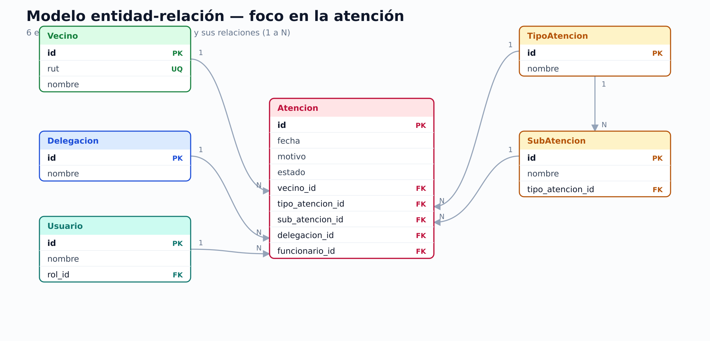

# Informe Técnico — Evaluación Sumativa #3

Sistema Municipal de Gestión de Atención Ciudadana — Abstergo

**Asignatura**: Programación Back End (TI3041)
**Carrera**: Ingeniería en Informática / Analista Programador
**Área**: Informática, Ciberseguridad y Telecomunicaciones
**Sede**: La Serena
**Docente**: Alex Díaz Araos
**Integrante**: Sebastian Gilberto Munoz
**RUT**: 20761674-5
**Fecha**: Primavera 2026

---

## 1. Descripción del proyecto

**Nombre**: Abstergo — Sistema Municipal de Gestión de Atención Ciudadana.
**Repositorio**: https://github.com/lacteada/abstergo

**Objetivo**
- Digitalizar y centralizar la gestión de atención ciudadana de las delegaciones municipales de La Serena, reemplazando las planillas manuales de Excel por una aplicación web con base de datos relacional, control de acceso por perfiles y trazabilidad.

**Problemática abordada**
- La información de atenciones, vecinos y territorios se llevaba en planillas dispersas, sin control de acceso, sin historial por vecino y sin una fuente única de verdad.

**Funcionalidades desarrolladas**
- Autenticación por correo y contraseña, con cierre de sesión y protección de vistas.
- Perfiles de usuario con permisos diferenciados y dashboards por perfil.
- Recuperación de contraseña por correo electrónico (token y enlace firmado).
- Mantenedores con CRUD completo (Delegaciones, Cargos, Roles, Usuarios, Metas, Tipos de atención, Sub atenciones y Vecinos) desde plantillas Django.
- Transacción operacional: registro de atención ciudadana con varias entidades relacionadas.
- Contexto de delegación, búsqueda, paginación y exportación a Excel.

**Stack**
- Python 3.14 · Django 6.1 · MariaDB (driver `mysqlclient`).
- Django Templates + formularios de Django + Django ORM.
- Despliegue: AWS EC2 (Apache + gunicorn + MariaDB) y repositorio en GitHub.

---

## 2. Seguridad

**Estructura de roles** (roles como dato, `Rol.codigo`)

| Perfil de la evaluación | Rol del sistema | Acceso |
|---|---|---|
| Administrador | `admin` | Total: mantenedores, transacciones, usuarios, roles y visión global. |
| Supervisor | `coordinador` | Intermedio: alcance global de lectura; sin administración de usuarios/roles. |
| Administrativo | `delegado`, `funcionario`, `verificador`, `consulta` | Mínimo: acotado a su delegación. |

- Además del rol (categoría de acceso), cada persona puede tener un **cargo** (puesto funcional), que suma permisos sobre los módulos operativos.

**Permisos implementados**
- Una sola fuente de verdad: `apps/common/permisos.py` (matriz rol × módulo y cargo × módulo). La web la aplica con `PermisoRequeridoMixin` y la API con `PermisoPorRol`.
- Cada rol se refleja como un `auth.Group` de Django con sus permisos (espejo), y el usuario queda en el grupo de su rol.
- El menú lateral y el dashboard muestran solo lo autorizado.

**Flujo de autenticación**
- Ingreso por correo y contraseña (sesión de Django); cierre de sesión por POST.
- Toda vista interna exige autenticación; sin permiso, responde 403.
- Recuperación: se genera un código OTP de 6 dígitos y un enlace firmado, se envían por correo, se validan y se fija la nueva contraseña. La cuenta se deshabilita al pedir la recuperación y se reactiva al guardar la nueva clave.

---

## 3. Base de datos

- Motor relacional: **MariaDB**. Modelo entidad-relación (mínimo, centrado en la atención): `documentacion/modelo_datos_minimo.png` (y `.svg`). El esquema físico completo (`modelo_datos.png`) queda como anexo.
- Migraciones versionadas en cada app (`apps/*/migrations/`).
- Entidades: `Delegacion`, `Cargo`, `Rol`, `Usuario`, `Meta`, `TipoAtencion`, `SubAtencion`, `Vecino`, `Atencion` y las tablas de cumplimiento de la Ley 21.719.
- Relaciones principales (todas `PROTECT`): `Usuario.rol`→`Rol`, `Usuario.cargo`→`Cargo`, `Usuario.delegacion`→`Delegacion`, `Meta.delegacion`→`Delegacion`, `SubAtencion.tipo_atencion`→`TipoAtencion`, `Vecino.territorio`→`Delegacion`, `Atencion.vecino`→`Vecino`, `Atencion.delegacion`→`Delegacion`, `Atencion.funcionario`→`Usuario`.

El modelo completo, con campos y descripción, está en `documento_tecnico.md` (§ modelo de datos) y en el diagrama E-R.

---

## 4. Evidencia de interfaces

- Login.
- Recuperación de contraseña (solicitud, correo recibido, formulario de nueva contraseña).
- Dashboard Administrador.
- Dashboard Supervisor.
- Dashboard Administrativo.
- Mantenedor (listado + alta/edición + consulta).
- Transacción (registro de atención con búsqueda del vecino y validación tipo/sub atención).

---

## 5. Evidencia de AWS

- Instancia EC2 en ejecución (consola de AWS).
- Aplicación respondiendo en el navegador (URL del despliegue).
- Nota: la aplicación debe estar **desplegada y operativa** al momento de la revisión; comandos en `documentacion/despliegue_aws.md`.

---

## 6. Evidencia de GitHub

- Repositorio: https://github.com/lacteada/abstergo
- Historial de commits con desarrollo incremental.
- `.gitignore` presente.

---

## 7. Evidencia de IA

- Registro de prompts y respuestas, con su aplicación al desarrollo: `documentacion/prompts.md`.
- Uso de IA como apoyo en: modelo de datos, RBAC (roles/cargos/grupos), flujo de autenticación, recuperación de contraseña y documentación.
