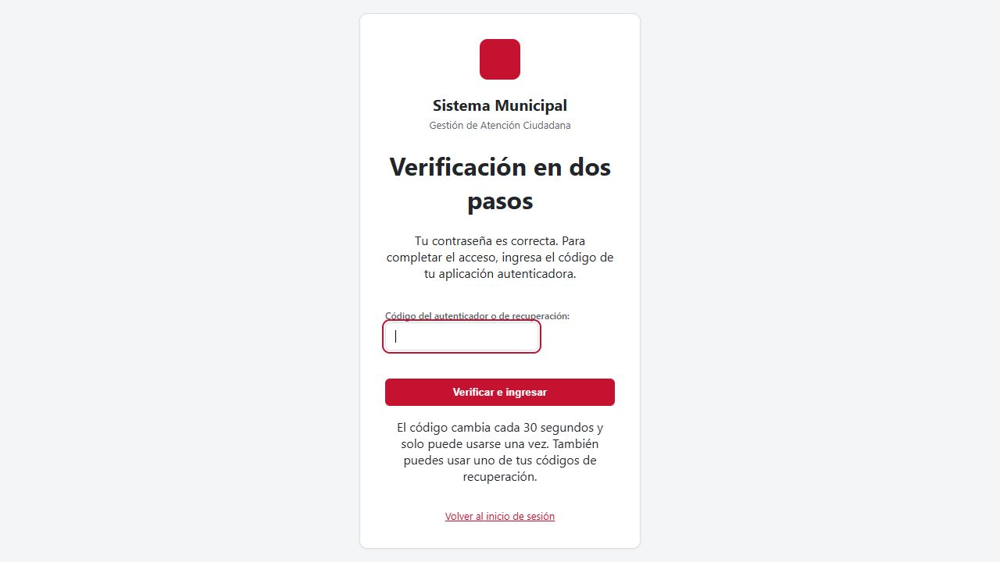
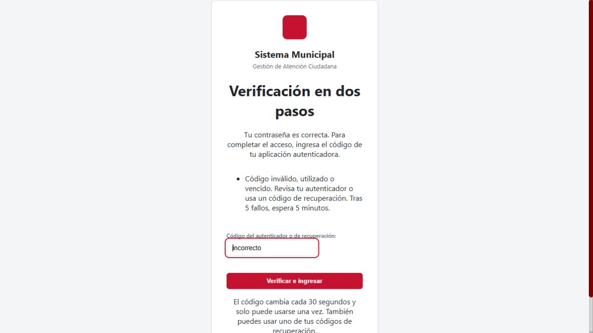
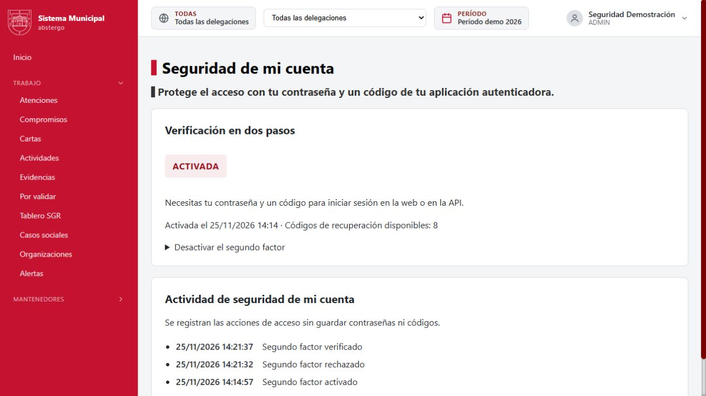
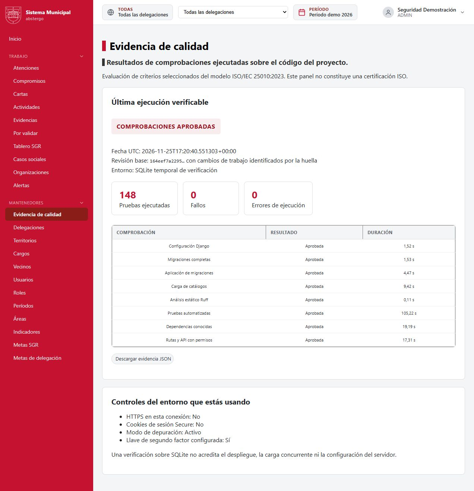

# Seguridad y calidad demostrables en Abstergo

Implementación del 25 de noviembre de 2026 sobre `origin/main` 164eef7. La demostración usa cuentas ficticias y una base SQLite aislada. Las capturas muestran el funcionamiento observado; los resultados de verificación se entregan además en JSON, JUnit y logs.

## Qué mostrar durante la presentación

1. Entrar con una cuenta que tenga segundo factor activado. Después de la contraseña aparece una segunda pantalla y todavía no existe una sesión autenticada. Intentar abrir un módulo en otra pestaña devuelve al login.
2. Ingresar un código incorrecto: el acceso se rechaza. Cinco fallos bloquean el factor durante cinco minutos. El control persistente también funciona en el entorno local.
3. Ingresar un TOTP actual o una recuperación no utilizada y acceder al sistema. Un código ya consumido se rechaza. Los TOTP admiten una tolerancia de un paso de 30 segundos por desfase de reloj.
4. Abrir el menú del usuario, Seguridad y segundo factor: comprobar el estado activado y su bitácora. No abrir ni mostrar la clave manual o los códigos de recuperación en una presentación pública.
5. Con admin o coordinador, entrar en Mantenedores, Evidencia de calidad. Mostrar fecha UTC, revisión, huella de código, pruebas, fallos y las comprobaciones. Descargar la evidencia JSON.
6. Mostrar una validación del sistema, por ejemplo un formulario incompleto. La interfaz y el servidor mantienen sus validadores; las pruebas comprueban el comportamiento y los permisos.



La contraseña correcta solo inicia un desafío de cinco minutos; el acceso se completa con el segundo factor.



El rechazo sucede en el servidor. Cambiar el HTML o usar la API no elimina la comprobación.



La pantalla permite comprobar el estado de la cuenta y las acciones de seguridad sin exponer los códigos.



La información se carga desde una ejecución firmada. Sin reporte válido se muestra Sin evidencia disponible. Si cambia el código, aparece una advertencia; si pasan más de siete días, se pide actualizar la evidencia.

## Implementación y justificación

| Control | Comportamiento verificable | Ubicación |
| --- | --- | --- |
| TOTP | Contraseña y posesión del autenticador antes de iniciar sesión | `apps/cuentas/acceso.py`, `mfa.py` |
| Cifrado de la semilla | Fernet con llave independiente de SECRET_KEY | `SegundoFactor.secreto_cifrado`, `MFA_ENCRYPTION_KEY` |
| Recuperación | Ocho códigos aleatorios de 128 bits, guardados con hash y consumibles una sola vez | `mfa.activar`, `mfa.verificar` |
| Antirreutilización | Persiste y compara el último contador TOTP aceptado; consume recuperaciones mediante actualización condicional | `mfa.verificar` |
| Bloqueo | Cinco fallos consecutivos bloquean cinco minutos, por cuenta | `SegundoFactor.fallos`, `bloqueado_hasta` |
| Reautenticación | Alta con contraseña y TOTP; baja con contraseña y TOTP o recuperación | `seguridad.py` |
| API y Admin | API exige otp para cuenta vinculada; tokens y refresh comprueban versión; login Admin usa el flujo común | `apps/api/autenticacion.py`, `ExigirSegundoFactor` |
| Revocación | Cambios del factor invalidan sesiones y tokens previos; JWT comprueba cambios de contraseña | `mfa_version`, `CHECK_REVOKE_TOKEN` |
| Privacidad | No-store en páginas sensibles; bitácora sin secretos; la semilla no se expone por API ni Admin | `seguridad.py`, `EventoAcceso` |
| Aislamiento | Perfil territorial sin delegación no obtiene datos de todas las delegaciones | `apps/common/delegaciones.py` |
| Evidencia | JSON firmado, revisión y SHA-256 de las fuentes; la web no ejecuta la suite | `apps/panel/calidad.py` |
| Automatización | Check, migraciones, catálogos, Ruff, pytest/JUnit, pip-audit y smoke | `scripts/verificar_calidad.py` |

El factor es optativo por cuenta: los usuarios existentes siguen entrando con contraseña hasta vincular su autenticador. No se afirma que todas las cuentas lo tengan activado. La recuperación por correo conserva la credencial MFA y no la desactiva.

## Calidad basada en un modelo reconocido

Se utiliza ISO/IEC 25010:2023 como referencia para seleccionar criterios del producto. No se declara certificación ISO, auditoría externa ni conformidad completa. La norma define un modelo de calidad; ejecutar pruebas no certifica por sí solo un sistema de gestión ISO 9001 o ISO/IEC 27001.

| Criterio seleccionado | Evidencia del proyecto | Límite |
| --- | --- | --- |
| Adecuación funcional | Pruebas de flujos, reglas, CRUD y validaciones | Debe ampliarse con la aceptación de usuarios |
| Fiabilidad | Regresión, migraciones aplicables y smoke reproducible | No mide disponibilidad del servidor ni recuperación ante desastres |
| Mantenibilidad | Ruff, dependencias fijadas, pruebas y pipeline versionado | No sustituye revisión de arquitectura ni mantenimiento continuo |
| Seguridad | TOTP, permisos, CSRF, bloqueo, revocación y aislamiento territorial | TOTP no resiste phishing como WebAuthn; no es un pentest integral |

La duración de las comprobaciones corresponde al entorno de pruebas. No se presenta como tiempo de respuesta del sistema ni como prueba de carga. Pip-audit identifica vulnerabilidades conocidas en la fuente consultada; un resultado sin hallazgos no demuestra ausencia de vulnerabilidades.

## Reproducir la verificación

Instalar dependencias en un entorno virtual:

```text
python -m pip install -r requirements.txt -r requirements-dev.txt
python manage.py migrate --noinput
python manage.py check
python scripts/verificar_calidad.py
```

La configuración debe proporcionar SECRET_KEY para firmar el reporte. El script crea SQLite temporal y nunca ejecuta pruebas sobre la base de producción. Guarda `var/calidad.json`, logs por etapa y `var/comprobaciones/pytest.xml`; la ubicación del JSON puede cambiarse con `--salida` y `QUALITY_REPORT_PATH`.

En Linux se conserva `bash scripts/verificar.sh` como comprobación oficial del repositorio. En este equipo no hay Bash y la revisión automática bloqueó descargar y ejecutar Git portable; se ejecutó el verificador Python y su bloque smoke se extrae del script Bash original. No se afirma haber ejecutado Bash aquí.

La firma debe generarse con la SECRET_KEY del entorno que visualizará el reporte. El artefacto de CI usa una llave de verificación sin secretos de producción; para mostrarlo en el panel de otro entorno debe regenerarse allí. La huella compara fuentes, plantillas, estáticos, dependencias y configuración de CI. Sin un checkout Git verificable, el panel avisa que no puede confirmar la coincidencia.

## Configurar segundo factor

1. Generar una llave con `python -c "from cryptography.fernet import Fernet; print(Fernet.generate_key().decode())"`.
2. Guardarla como MFA_ENCRYPTION_KEY en el entorno privado, fuera del Git. Respaldar la llave de forma separada de la base; reemplazarla sin migrar semillas impide verificar credenciales existentes.
3. Iniciar sesión y abrir Seguridad y segundo factor desde el menú del usuario.
4. Confirmar contraseña, escanear QR o ingresar clave manual en el autenticador y confirmar un código actual. El QR se genera localmente; no se envía a un servicio externo.
5. Guardar las ocho recuperaciones que se muestran una sola vez. Cerrar sesión y probar el flujo completo.

No existe una omisión de MFA por correo ni un botón administrativo de reinicio. Ante pérdida del autenticador y de todas las recuperaciones se necesita un procedimiento de identificación y recuperación administrado, todavía fuera del alcance de esta entrega. No borrar factores directamente para una demostración sobre cuentas reales.

## Requisitos y límites de despliegue

- Usar HTTPS válido, DEBUG=False, reloj sincronizado y cookies Secure. El panel muestra la configuración de la conexión actual, por lo que la demo local HTTP aparece como tal.
- Activar PRODUCCION_SEGURA=1 solo detrás de un proxy correctamente configurado. Para el límite general por IP en varios procesos se requiere caché compartida; el límite de MFA por cuenta reside en la base de datos.
- Ejecutar `python manage.py check --deploy --fail-level WARNING`. La comprobación propia cuentas.E001 rechaza una llave MFA ausente o inválida.
- Aplicar migración cuentas/0009, recopilar estáticos, copiarlos al directorio servido por Apache y reiniciar según AGENTS.md. Preservar la base y el .env existentes.
- GitHub Actions contiene el pipeline y la conservación de artefactos. No se afirma que una ejecución remota nueva haya ocurrido hasta publicar los cambios y observarla.

## Fuentes

- ISO, ISO/IEC 25010:2023, Product quality model: https://www.iso.org/standard/78176.html
- OWASP, Multifactor Authentication Cheat Sheet: https://cheatsheetseries.owasp.org/cheatsheets/Multifactor_Authentication_Cheat_Sheet.html
- PyOTP, documentación y lista de controles de seguridad: https://pyauth.github.io/pyotp/
- Simple JWT, configuración y revocación: https://django-rest-framework-simplejwt.readthedocs.io/en/latest/settings.html

Consultadas el 25 de noviembre de 2026. Las capturas corresponden a una simulación académica con cuentas ficticias; los controles y las comprobaciones son implementaciones y ejecuciones reales.
